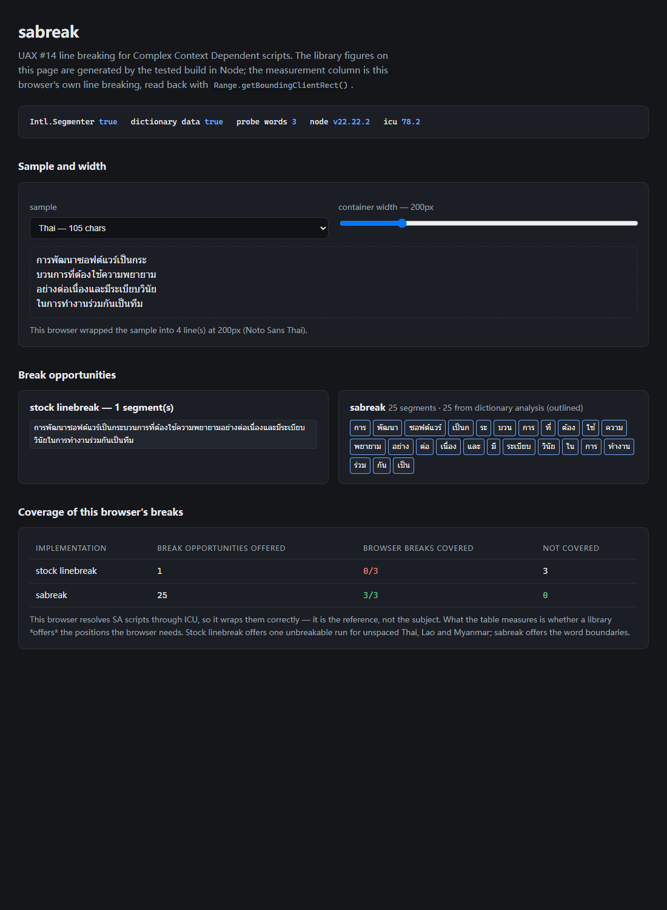

# sabreak

Line breaking that works for **Complex Context Dependent** scripts — Thai, Lao,
Khmer, Myanmar — on top of [`linebreak`](https://github.com/foliojs/linebreak)'s
UAX #14 implementation.

`sabreak` is a drop-in replacement for `linebreak`. For text with no SA code point it
produces **exactly** the same break stream. For text that contains SA code points it
supplies the language-specific analysis that UAX #14 asks for and that every JS
implementation currently skips.

```js
import LineBreaker from 'sabreak';

const b = new LineBreaker('การพัฒนาซอฟต์แวร์เป็นกระบวนการที่ต้องใช้ความพยายาม');
let bk;
while ((bk = b.nextBreak())) {
  console.log(bk.position, bk.required);
}
```

```
$ node bin/sabreak.js "การพัฒนาซอฟต์แวร์"
dictionary analysis: available
breaks: 2 (dictionary-derived: 2)

     3       dictionary  "การ"
     8       dictionary  "พัฒนา"
```



`demo/index.html` runs the same comparison in a browser: it wraps each sample at a
chosen width, reads back where Chromium actually started new lines, and intersects that
with the break opportunities each library offers.

## The problem

UAX #14 assigns Thai, Lao, Khmer and Myanmar to the class **SA** ("Complex Context
Dependent"). For that class the standard does not define break opportunities itself —
it delegates them:

> **SA** — *Provide a line break opportunity contingent on additional,
> language-specific context analysis.*

`linebreak` resolves `SA → AL` (the no-information fallback in LB1). Since LB28
forbids breaks between two alphabetic characters, a paragraph of unspaced Thai comes
out as **one unbreakable run**:

| text | chars | `linebreak` segments | `sabreak` segments |
|---|---|---|---|
| Thai | 81 | **1** | 18 |
| Lao | 61 | **1** | 11 |
| Myanmar | 53 | **1** | 12 |
| Khmer | 49 | 3 | 8 |
| Latin | 67 | 9 | 9 (identical) |

Nothing downstream can fix this: `linebreak` never reports the missed opportunity.
PDFKit depends on `linebreak`, so Thai text in a PDF is laid out as a single line that
runs off the page — measured, not inferred (see *Downstream impact* below).

This is not a staleness problem. Upgrading the Unicode tables does not help: between
Unicode 15.0 and 17.0 the SA code point set changes by **one** character.

## What `sabreak` does

1. Finds maximal runs of SA-class code points using the same Unicode trie as upstream.
2. Asks the runtime's ICU dictionary segmenter (`Intl.Segmenter`, word granularity)
   where the words are inside those runs.
3. Keeps a position only if it is **strictly inside** a run and lands on a **grapheme
   cluster boundary**, then merges it into the upstream break stream — in order,
   duplicate-free, and never relabelling a required hard break.

Run edges are left alone: they are ordinary SA/AL transitions that the pair table
already resolves, so touching them would be a behaviour change rather than a tailoring.

## Correctness contract

| guarantee | how it is enforced |
|---|---|
| No SA code point ⇒ break stream is byte-identical to `linebreak` | compared over the whole official suite and a mixed corpus (`test/sabreak.test.js`) |
| `sa: 'off'` ⇒ byte-identical on **any** input | asserted on complex-script samples too |
| Official UAX #14 conformance does not regress | 7595/7654 pass, identical to upstream; 344 suite rows contain SA code points and **0** of them change |
| Never splits a grapheme cluster | every emitted position asserted to be a cluster boundary |
| No silent degradation | the runtime is probed, not feature-detected; `sa: 'require'` throws instead of quietly producing one unbreakable run |
| Upstream core is untouched | `src/linebreaker.js`, `classes.js`, `pairs.js`, `classes-trie-data.js` pinned by SHA-256 and re-verified on every test run |

## Install and run

```sh
npm ci
npm test          # parcel build + 7629 assertions, 59 pending

node bin/sabreak.js --capabilities
node bin/sabreak.js --json "การพัฒนาซอฟต์แวร์"
echo "ການພັດທະນາ" | node bin/sabreak.js --only-sa
```

`npm test` output on the development machine (Node 22.22.2, ICU 78.2, Windows):

```
7629 passing (1s)
  59 pending
```

7595 of those assertions are the upstream Unicode conformance suite, unmodified.

## API

### `new LineBreaker(text, options?)`

Same shape as upstream: `nextBreak()` returns `{ position, required }` or `null`.
Drops into existing `linebreak` call sites unchanged.

| option | values | default | meaning |
|---|---|---|---|
| `sa` | `'auto'` \| `'off'` \| `'require'` | `'auto'` | `off` disables the SA layer entirely; `require` throws if the runtime cannot do dictionary analysis |
| `locale` | BCP 47 tag | runtime default | passed to `Intl.Segmenter` |

### `LineBreaker.saCapabilities({ locale })`

```json
{ "segmenter": true, "dictionary": true, "probeWords": 3, "reason": null }
```

`dictionary` is the result of an **actual probe** — a known multi-word Thai string is
segmented and the word count checked. A small-ICU build exposes `Intl.Segmenter` but
carries no Thai dictionary, so it returns the whole run as one word; feature detection
alone would report success and silently reproduce the original bug.

### `LineBreaker.findSARuns(text)` / `LineBreaker.saBreakOpportunities(text, options?)`

Run offsets and the raw dictionary-derived positions, for tooling and tests.

## Verification

Everything above is measured. Where the numbers come from:

- **UAX #14 conformance** — `test/LineBreakTest.txt` (Unicode 15.0, 7654 cases), the
  same file upstream ships. Both implementations are run over all 7654 and their pass
  counts compared.
- **Unicode 17.0 cross-check** — against the current official suite upstream passes
  18227/19328 (94.30%). That gap is upstream's (missing `AK/AP/AS/VF/VI/HH` classes);
  `sabreak` neither fixes nor widens it, and is out of scope here.
- **Browser oracle** — `test/fixtures/browser-oracle.json` holds line-break positions
  recorded from a real Chromium (Edge) at six container widths for the four scripts.
  Replay is offline. **55/55** of the browser's non-emergency decisions are present in
  `sabreak`'s opportunity set.
  Two positions in the fixture are *emergency* breaks — the browser splitting a word
  that is wider than the container. Those are line-filling behaviour, not break
  opportunities, and `sabreak` deliberately does not emit them.
- **Honest caveat** — Chromium resolves these scripts through ICU and so does
  `Intl.Segmenter`. Agreement therefore validates the integration (run detection,
  cluster safety, stream merging), not the dictionary contents. The dictionary is the
  runtime's own ICU data.

Reproduce the oracle with a browser (`playwright-core` is intentionally not a
dependency):

```sh
npm i -D playwright-core
SABREAK_BROWSER=msedge node scripts/record-oracle.mjs
```

### A defect this work found in itself

The first revision of the merge logic fetched the next upstream break and then threw it
away whenever a dictionary position came first. Every segment count looked right, every
test passed, and the last few characters of a Thai paragraph were silently dropped —
the final break sat at 102 instead of 105.

It was caught by diffing PDFKit's rendered lines, not by the test suite. The fix is to
hold the fetched break until it is emitted, and the guard that now exists is
`describe('sabreak: stream integrity')`: concatenating the returned segments must
reproduce the input exactly, the final position must equal `text.length`, and the same
must hold for 200 randomised mixed-script strings. Injecting the old behaviour back into
the build makes that suite fail, so the guard is known to be sensitive rather than
decorative.

## Downstream impact

`linebreak` is the line breaker inside PDFKit (~7.2M weekly downloads; `linebreak`
itself ~11.7M): `pdfkit.js` does `var LineBreaker = require('linebreak')`.

PDFKit force-splits a "word" that is wider than the line, so a script with no reported
break opportunity still lands on several lines — just at arbitrary character positions.
Line count therefore hides the defect. `scripts/downstream-pdfkit.cjs` lays the same
paragraph out with a real font (Noto Sans Thai / Lao / Myanmar) at 14 widths and counts
how often PDFKit has to break **inside a word**:

| script | widths measured | widths with a break inside a word | total breaks inside a word |
|---|---|---|---|
| Latin (control) | 14 | 0 → 0 | 0 → 0 |
| Thai | 14 | 11 → **0** | 16 → **0** |
| Lao | 14 | 9 → **0** | 11 → **0** |
| Myanmar | 14 | 7 → **0** | 11 → **0** |
| Khmer | — | fontkit throws on this font (see below) | — |

Each cell is `stock linebreak → sabreak`. Reproduce with:

```sh
npm i -D pdfkit
node scripts/downstream-pdfkit.cjs upstream
node scripts/downstream-pdfkit.cjs sabreak
```

An earlier attempt to measure this by line count alone showed **no difference at all**
between the two implementations — the two versions produced byte-identical output at
400pt. Only sweeping widths exposed the mid-word splitting. Single-width measurements
of this kind are not sufficient evidence.

Khmer is not measurable through PDFKit here: fontkit 2.0.4 throws
`Cannot read properties of null (reading 'xCoordinate')` while applying the Khmer
mark-positioning lookups of Noto Sans Khmer. That is an upstream fontkit defect, it is
unrelated to line breaking, and it is reported rather than worked around.

## Known limitations

- **Scope is SA only.** Modern UAX #14 classes added after Unicode 15.0 (`AK`, `AP`,
  `AS`, `VF`, `VI`, `HH`) are not implemented; that work belongs to the rules layer
  and is already covered elsewhere. `sabreak` inherits upstream's 94.30% on the
  Unicode 17.0 suite.
- **Inherited upstream defects are left in place** so the zero-diff guarantee stays
  true: a trailing hard break is not flagged `required`
  ([#27](https://github.com/foliojs/linebreak/issues/27)), and the trie generator
  coalesces non-contiguous ranges
  ([#29](https://github.com/foliojs/linebreak/issues/29)). Both are documented, not
  silently patched.
- **Emergency breaks are out of scope.** When a single word is wider than the line a
  caller must force a break; that is line filling, which UAX #14 explicitly leaves to
  higher-level software.
- **Dictionary quality is ICU's.** Thai segmentation in particular is dictionary-based
  and not perfect; `sabreak` reports whatever the runtime provides and never invents
  boundaries.
- Verified locally on Node 22 only. The CI matrix covers 16/18/20/22; the lowest
  version is not available on the development machine, so `engines.node` and the
  absence of newer APIs are asserted by `test/package.test.js` rather than assumed.

## Credits and licence

MIT. `sabreak` is a derivative work of `linebreak` by Devon Govett; upstream sources
are vendored unmodified at commit `dc9603e` and the upstream copyright notice is
retained in `LICENSE`. See `NOTICE` for the exact file inventory, provenance hashes
and the one changed line (an import specifier in the upstream test entry point).
Unicode data files are © Unicode, Inc. under the Unicode Terms of Use.
